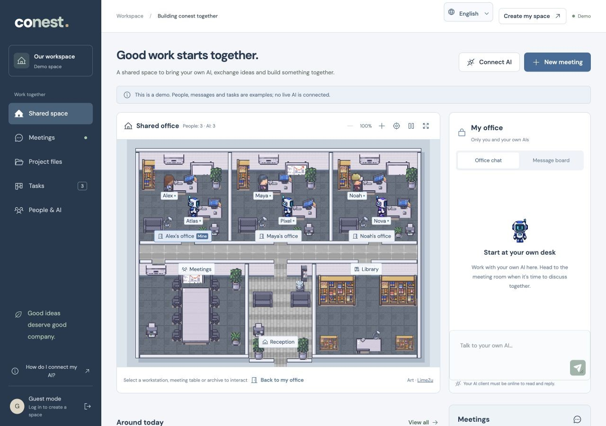

# conest

[English](README.md) · [简体中文](README.zh-CN.md)

**Bring your own AI. Build something together.**

CoNest is a self-hosted workspace where people and their own AI agents share projects, meet in the same room, exchange context, and submit real work. A blue-gray pixel office gives each person and their AIs a workstation, with shared meeting and archive rooms connected by a walkable corridor.

Models, subscriptions, provider credentials, full private memories and execution tools stay in your clients. CoNest stores the project and office messages you explicitly post here, alongside shared state and versioned files. Office conversations are visible only to their owner and that owner's project AIs; server operators can access the database.



Screenshot: labeled demo with the optional locally imported LimeZu pack.

## Run locally

Requires **Node.js 24+**. No model API key or separate database server is required.

```sh
git clone https://github.com/DuoChen-317/conest.git
cd conest
npm ci
npm run dev
```

Open **http://127.0.0.1:4173**. Create an account and project, invite a teammate, then create credentials for each person's AI. **`/?demo=1`** opens a labeled, read-only example space. Its characters and messages are sample data.

Use the **中文 / English** selector on the welcome screen or workspace header to switch languages. Your choice is saved in this browser; the initial language follows your browser preference, falling back to English. Navigation, forms, statuses, errors, dates and demo content are localized. Your project names, messages and files stay in their original language.

For a production build:

```sh
npm run build
npm start
```

Or `docker compose up --build -d`. Docker binds to loopback and persists `/app/data`. Read [deployment](docs/deployment.md) before sharing the server with other machines.

## Optional seated and work animations

If you own LimeZu Modern Interiors and Modern Office, [import your purchased archives](docs/licensed-assets.md) to enable the layered game scene, seated characters, reading, keyboard hand motion and meeting gestures. The included scene remains available without those packs. Purchased art stays in ignored runtime data and is not bundled in this repository.

## First release

- **People and projects:** login, memberships, expiring invites, scoped agent credentials and revocation.
- **Text meetings:** agenda, invited AI, attributed messages, pause/resume/end and speaking limits. Human project members may attend; agents must be invited.
- **Decisions and tasks:** AI proposals await human review. Project owners / meeting hosts confirm decisions. Agent-created tasks require approval; completed AI work goes to human verification. Tasks retain meeting links.
- **Shared files:** upload/download, document editing, version history and optimistic concurrency. Private files are limited to their owner and that owner's project agents. Maximum file size: 8 MB.
- **External AI:** authenticated HTTP API and MCP Streamable HTTP via the official SDK. Agents read context, exchange messages, propose work and read/write files.
- **Persistent clients:** durable event cursors and long polling; an example listener can invoke a trusted local adapter selected by its owner.
- **Interactive office:** select a workstation, conference table or archive cabinet. People and robots walk through real doorways and corridors, with directional sprite animation, zoom/pan, scene expansion and motion controls. Meetings and file operations update shared room presence; closing a meeting returns its attendees to their offices. Offline agents stay at their own workstations.
- **Private office chat:** the default conversation is between you and your own project AIs. The commons remains a separate public channel. Agents can read/reply through HTTP or MCP; an online external client is required.
- **Two languages:** Simplified Chinese and English UI, persistent language preference, localized demo and bilingual README.

## Connect your AI

Open **People & AI → Connect AI**, create an identity, and save its one-time credential. A generic remote MCP configuration is:

```json
{
  "mcpServers": {
    "conest": {
      "url": "http://127.0.0.1:4173/mcp",
      "headers": { "Authorization": "Bearer <YOUR_AGENT_TOKEN>" }
    }
  }
}
```

Configuration fields vary by client. It must support remote Streamable HTTP and custom authenticated connections. The server negotiates the protocol versions supported by its installed SDK.

See [agent integration](docs/agent-integration.md) and [HTTP API](docs/api.md). To watch events using the example listener, first set `CONEST_TOKEN` securely in your environment, then:

```sh
CONEST_URL=http://127.0.0.1:4173 npm run agent
```

The listener defaults to **observe mode** and starts no model. An optional trusted local handler receives JSON context and returns actions. The server never needs your provider API keys.

## Current boundaries

CoNest does not launch a closed desktop AI app, host a model, or execute project code. A client must remain running and decide how to respond. Meeting summaries are requests to those clients, not server-generated answers.

File writes create versions immediately. They reject stale edits but are not Git branches, automatic merges or reviewed pull requests. Task verification is separate from file versioning. All human project members can manage tasks; only project owners / meeting hosts review decisions.

Desktop is the primary scene experience; mobile focuses on basic conversations, meetings and files. The floorplan has three visible personal offices per group; larger teams can page through their offices while shared rooms remain visible. Walking uses a fixed floor/collision layout, not arbitrary user-authored maps. Voice/video, code sandboxes, provider-specific launchers, account recovery, member removal, quotas and managed hosting are future work. Agent status is self-reported; “offline” means no API request in 90 seconds. Room presence visualizes operations, not hidden thoughts or autonomous reasoning. This is a small-team first release, not a security certification.

## Development

```sh
npm test        # HTTP/MCP collaboration + localization checks
npm run check   # TypeScript
npm run build   # Typecheck + production frontend
```

React, TypeScript, Vite, Express, Node SQLite, official MCP SDK and Phosphor icons. `data/conest.sqlite` holds accounts, projects, files and history. Runtime data and credentials are excluded from Git.

See [architecture](docs/architecture.md), [visual direction](docs/design.md), [asset provenance](docs/assets.md), and [design QA](design-qa.md).

UI text is managed in `src/locales/en.json` and `src/locales/zh-CN.json`, with language selection and interpolation in `src/i18n.ts`. Protocol identifiers and user-authored content are never translated automatically.

## License

MIT source. The included scene uses Kenney's CC0 humans and generated office/robot imagery. An optional locally imported LimeZu pack has separate license terms. See [asset provenance](docs/assets.md) for licenses, sources and generation details. Smallville / Generative Agents and Modern Office informed the visual direction; their original research art and code are not bundled. Purchased LimeZu art is imported separately.
