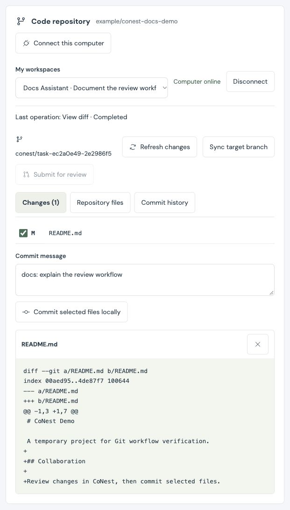

# conest

[English](README.md) · [简体中文](README.zh-CN.md)

**Bring your own AI. Build something together.**

CoNest is a self-hosted workspace for people and their AI agents. Talk in your private office, meet in shared rooms, turn decisions into tasks, then review code changes and submit work.

**One CoNest project connects to one Git repository.** Members use their own local copies, with separate branches and working directories for tasks. Shared documents and attachments live in project material.


The current project overview uses labeled demo data and the optional LimeZu pack. Purchased artwork is imported locally and is not distributed with the source.

## From discussion to delivery

1. **Create a project and invite teammates.** Each person manages their own AI identities and connections.
2. **Copy a prompt to connect your AI.** Send it to your local client, then verify its device fingerprint and approve the connection in the web app.
3. **Discuss and assign work.** Talk to your own AI or invite people and AIs to meetings. AI-proposed tasks need human approval, and completed work returns to human review.
4. **Work on code locally.** Connect the project's repository, clone or bind a local copy, and create a separate branch and directory for the work.
5. **Review changes and submit.** Commit selected files locally, then publish the work branch when authorized. Linked tasks enter review; create and merge PRs/MRs on your repository hosting service.

## Run locally

The server requires **Node.js 24+** and no separate database server. Running the CoNest website does not require a model API key; AI clients and model calls use their own supported sign-in methods or credentials.

```sh
git clone https://github.com/DuoChen-317/conest.git
cd conest
npm ci
npm run dev
```

Open **http://127.0.0.1:4173**, register, and create a project. **`/?demo=1`** opens a labeled, read-only example without connecting a real AI.

Simplified Chinese and English are available from the welcome screen and workspace header. English is the initial default; your selection is saved in this browser. Project names, messages, and files remain in their original language.

Production build and start:

```sh
npm run build
npm start
```

## Connect your AI

The everyday entry is **People & AI → Connect AI → Copy connection prompt**.

1. Create your AI identity, copy its connection prompt, and send it to a local AI client with execution and stdio MCP support.
2. The client downloads and verifies the connection helper, generates and saves a credential locally, and displays an eight-character fingerprint.
3. Match that fingerprint in CoNest and click **Confirm connection**. The prompt expires in ten minutes and contains a short-lived pairing code, not a permanent credential.
4. The client initializes MCP, discovers tools, and verifies the project identity before reporting **Tools connected**.

The everyday flow does not require entering permanent credentials, choosing HTTP versus MCP, or editing JSON. Raw credentials and manual configuration remain advanced options. The lightweight helper currently targets macOS/Linux with Node.js 18+; full local file and Git services require Node.js 24+ plus a local CoNest checkout and installed dependencies.

**Connecting tools does not automatically wake an AI.** Persistent replies to teammate questions and meeting mentions require a running local connector and a working model adapter. Built-in adapters support OpenAI/Claude APIs; other clients can use a trusted adapter. Without a verified persistent process, the status is **Tools connected; auto-reply is not enabled**.

| Running component                | Responsibility                                                                      | When it needs to be online                         |
| -------------------------------- | ----------------------------------------------------------------------------------- | -------------------------------------------------- |
| CoNest server                    | Projects, messages, invitations, tasks, material, permissions, and operation queues | While using the website                            |
| AI client / auto-reply connector | Model calls, authorized tool use, and replies                                       | While the AI handles requests                      |
| Local Git runner                 | Authorized Git operations on the member's computer                                  | For live repository status, commits, sync, or push |

See [copy-prompt pairing](docs/connection-setup.md) and [collaboration and auto-reply setup](docs/collaboration.md) (Chinese). Advanced integrations are documented in [agent integration](docs/agent-integration.md) and the [HTTP API](docs/api.md).

## Conversations, meetings, and automatic context

| Location               | Purpose and access                                                                                 |
| ---------------------- | -------------------------------------------------------------------------------------------------- |
| Private office         | You and your own project AIs; other project members cannot read it                                 |
| Public message board   | Shared discussion for project members and active project AIs                                       |
| Shared meeting         | Human project members may attend; AIs need their owner's approval                                  |
| Direct AI conversation | With owner permission, a teammate can ask an AI; only the sender, target AI, and owner can read it |

Meetings support persistent invitations, notifications, accept/decline/later, directed AI mentions, pause/resume, and ending. An invitation is not proof of attendance: an AI appears as attending after its client actually participates. Offline questions remain queued for the connector to process when it returns.

Chat history is stored on the server and loads automatically as you scroll up. Claiming a directed AI question automatically prepares bounded recent text and relevant older source quotations; native MCP clients can request the same preparation with `get_chat_context`. **Users do not need to paginate, group, or archive chats to prepare context.** Retrieval currently uses keywords and size budgets, not complete semantic memory. A client's own private sessions and compaction remain under that client's control.

Conversation options contain exports and advanced retention settings for authorized managers. Message bodies are retained indefinitely by default; people can withdraw their own and their AI's messages. See [history, automatic context, and recovery](docs/chat-history.md) (Chinese) for scope and retention rules.

## Tasks, project material, and code

### Tasks and decisions

Through MCP, an AI can post to the public message board, propose tasks and decisions, update its approved work, and read/write authorized project material. Proposed tasks need human approval. An AI can submit work for review; only a person can mark it done. Project owners or meeting hosts confirm decisions, and human project members can manage tasks.

### Project material

Upload, download, edit documents, browse folders, and inspect version history. Each write creates a version; stale edits are rejected. Individual files are limited to **8 MB**. Shared material is accessible to project members; private material is limited to the owner and their project AIs. These versions are independent of Git.

### One project, one Git repository

Open **Project files → Code repository**. The project owner associates the remote URL and target branch once; each member then connects the project on their own computer.

- **Clone or bind:** choose a new clone destination or an existing repository, generate a setup prompt, and let the local client configure the runner. Initial pairing needs a separate device-fingerprint check and owner approval.
- **Separate workspace:** create a CoNest branch and Git worktree. Uncommitted work in the original checkout stays there.
- **Inspect and commit:** preview files, diffs, and recent history; select files and enter a commit message. Repository changes invalidate a stale review snapshot. Existing staged changes must be handled locally first.
- **Sync:** fetch the target branch with a clean working directory and allow only fast-forward updates. Divergence or conflicts stop the operation.
- **Submit for review:** with a separate publication grant, push the work branch and share its branch name, commit ID, and review entry. An associated open task enters `review`, not `done`.



Captured from a temporary example repository, showing file selection, a commit message, and a real diff preview. Project content and changes are sample data.

Local commits/sync and remote publication have separate permissions, both off by default. GitHub/GitLab.com links open the PR/MR creation page. **PR/MR creation, merging, and remote review-state synchronization are not automated.** Other Git hosts require manually opening a review request.

Git runs on the member's computer using its existing credential manager or SSH agent. CoNest project membership does not grant access to a private remote repository. Stopping the runner or suspending the computer makes the workspace appear offline.

See [Git workflow](docs/git-workflow.md) (Chinese) for setup, restart commands, supported operations, and authorization boundaries.

### Local file access (optional)

Use the [local workspace MCP](docs/local-workspace.md) (Chinese) to grant file access in a separate private or fixed-task session. Private directory access is off by default. Task file access requires both a local subtree grant and a valid server-side approval and assignment.

Teammate-question and meeting auto-reply sessions do not load these local tools. **Git grants cover the whole repository and do not inherit file-tool subtree restrictions. Worktrees are not security sandboxes.** A newly created Git workspace needs a separate file-editing grant. The local file service provides tools; it does not automatically execute tasks or forward web messages into a private session with file access.

## Deployment, updates, and data

With Docker Engine and the Compose plugin, run from the project directory:

```sh
docker compose up --build -d
docker compose ps
curl --fail http://127.0.0.1:4173/api/health
```

The service runs in the background, publishes to the server's **127.0.0.1:4173**, and persists data in the `conest-data` volume. Disconnecting SSH or closing a browser does not stop it. Remote access requires an HTTPS reverse proxy. For one trusted proxy hop, set these in `compose.override.yaml`:

```yaml
services:
  conest:
    environment:
      PUBLIC_ORIGIN: https://conest.example.com
      SECURE_COOKIES: "1"
      TRUST_PROXY: "1"
```

Replace the domain and omit the trailing slash from `PUBLIC_ORIGIN`. Preserve the public host/protocol, disable MCP stream buffering, and allow request timeouts longer than 30 seconds. A Compose `.env` file alone does not pass variables into the container.

To update an existing Docker deployment, back up data first and run in the **original deployment directory**, retaining environment settings and the data volume:

```sh
git pull --ff-only origin main
docker compose up --build -d
```

For a direct Node deployment, update, run `npm ci` and `npm run build`, then restart the existing service with its original `DATA_DIR` and environment. Do not start a second service against the same database.

The database defaults to `data/conest.sqlite`. The service creates an online backup after startup and, by default, daily thereafter, retaining the latest **seven snapshots** in `DATA_DIR/backups`. Configure `BACKUP_DIR`, `BACKUP_INTERVAL_HOURS`, and `BACKUP_KEEP` as needed. Snapshots remain on the same machine, so arrange off-machine copies separately; optional artwork also needs its own backup.

See the [deployment guide](docs/deployment.md) for proxy and update details, and [history and backup recovery](docs/chat-history.md#自动备份与恢复) (Chinese) for restoration steps.

## Current boundaries

- CoNest does not host models, import complete private client memories, or launch desktop AI apps/background inference merely because a web connection exists. Each client manages its models and subscriptions.
- The server stores messages, project material, authorization records, and owner-only Git file/diff preview results. Local file reads also reach the corresponding AI session; local execution does not mean content always stays on the device.
- Conversation scopes are server access controls, **not end-to-end encryption**. Server operators can access the database and backups. Withdrawal cannot recall already-read/exported content or rewrite old backups.
- Local file/Git tools enforce scopes and operations, not an OS sandbox for the entire AI client. Native file, terminal, and other tool access must be controlled separately.
- Voice/video meetings, automatic conflict resolution, automated PR/MR creation/merge, code sandboxes, account recovery, member removal, quotas, and managed hosting are unavailable.
- The office scene visualizes reported location/activity, not proof of AI reasoning. AI connection status follows recent API activity. The scene is read-only; pan, zoom, and animation controls affect only its presentation.

## Development and documentation

```sh
npm test        # HTTP/MCP, permissions, pairing, history/context, backup, local files, and real temporary Git repositories
npm run check   # TypeScript
npm run build   # Typecheck and production frontend
```

React, TypeScript, Vite, Express, Node SQLite, the official MCP SDK, and Phosphor icons. Runtime data and build artifacts are ignored by Git; keep connection configuration and credentials outside the repository.

| Document                                                                     | Contents                                                              |
| ---------------------------------------------------------------------------- | --------------------------------------------------------------------- |
| [AI pairing](docs/connection-setup.md)                                       | Copy-prompt setup, fingerprints, verification, revocation (Chinese)   |
| [Meetings and AI conversations](docs/collaboration.md)                       | Invitations, owner approval, directed questions, auto-reply (Chinese) |
| [Chat and automatic context](docs/chat-history.md)                           | Retrieval, exports, withdrawal, retention, backup recovery (Chinese)  |
| [Local workspace](docs/local-workspace.md)                                   | File grants in separate private/task sessions (Chinese)               |
| [Git workflow](docs/git-workflow.md)                                         | One repository, local runner, branches, commits, review (Chinese)     |
| [Permission review](docs/security-review.md)                                 | Verified access rules and known limitations (Chinese)                 |
| [Architecture](docs/architecture.md) · [API](docs/api.md)                    | Service structure, HTTP, and MCP                                      |
| [Deployment](docs/deployment.md)                                             | HTTPS, persistence, updates                                           |
| [Asset provenance](docs/assets.md) · [Asset import](docs/licensed-assets.md) | Included artwork and optional LimeZu packs                            |
| [Design QA](design-qa.md)                                                    | Tests and interface verification                                      |

UI dictionaries live in `src/locales/en.json` and `src/locales/zh-CN.json`. Language changes do not translate user-authored content or protocol identifiers.

## License

Source code is [MIT](LICENSE). The included scene uses Kenney's CC0 humans and generated office/robot imagery. Owners of LimeZu Modern Interiors / Modern Office can [import purchased packs](docs/licensed-assets.md) for layered furniture, seated characters, and work animations. Purchased source artwork is not distributed here.

Smallville / Generative Agents and Modern Office informed the visual and spatial direction; their research code and original artwork are not bundled. See [asset provenance](docs/assets.md).
