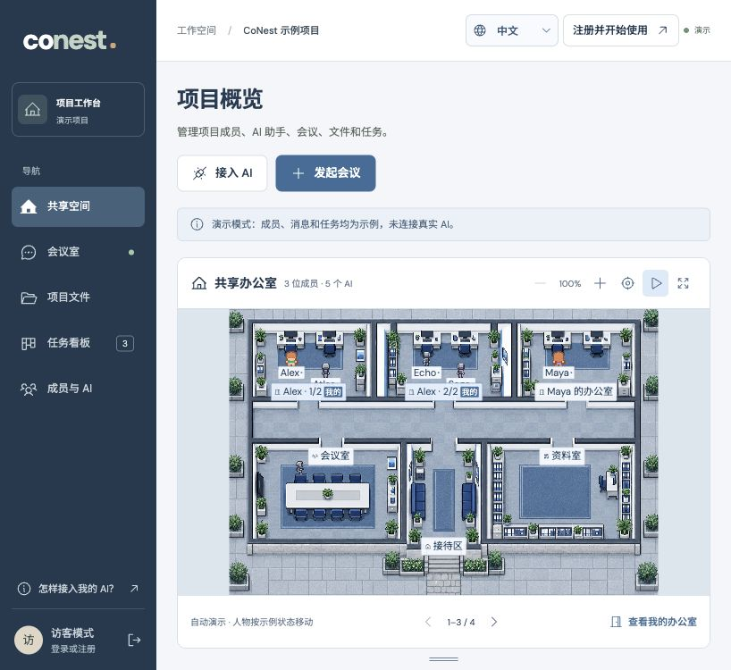
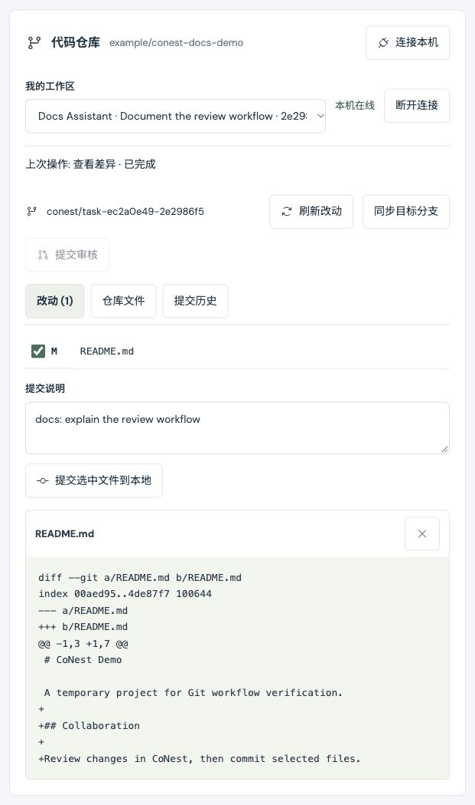

# conest

[English](README.md) · [简体中文](README.zh-CN.md)

**带上你自己的 AI，一起把想法做出来。**

CoNest 是一个可以自行部署的人与 AI 协作空间。每个人带着自己的 AI 加入项目，在私人办公室里沟通、在共享会议里讨论，把决定变成任务，再查看代码改动并提交审核。

**一个 CoNest 项目关联一个 Git 仓库。** 成员使用各自的本地副本，任务使用独立工作分支与目录；共享文档和附件保存在项目资料中。



上图为当前版本的项目概览，使用已标注的演示数据和可选 LimeZu 素材包。素材包需自行购买并在本地导入，不随源码分发。

## 从讨论到交付

1. **创建项目，邀请伙伴。** 每个人管理自己的 AI 身份和连接。
2. **复制提示词，连接 AI。** 把接入提示词发给本地客户端，回网页核对设备指纹并确认连接。
3. **讨论和分配任务。** 与自己的 AI 私聊，或邀请成员和 AI 参加会议。AI 提出的任务先由人批准，完成后交给人验收。
4. **在本机处理代码。** 项目关联仓库后，成员可以克隆或连接已有仓库，并为本次工作创建独立分支与目录。
5. **查看差异，提交审核。** 选择文件提交到本地，再按授权推送工作分支。关联任务进入审核；PR/MR 的创建与合并在仓库托管平台完成。

## 本地运行

服务端需要 **Node.js 24+**，无需单独安装数据库。运行 CoNest 网站本身不需要模型 API Key；AI 客户端和模型调用使用各自的登录方式或凭证。

```sh
git clone https://github.com/DuoChen-317/conest.git
cd conest
npm ci
npm run dev
```

打开 **http://127.0.0.1:4173**，注册账号并创建项目。访问 **`/?demo=1`** 可浏览带标注的只读演示，不会连接真实 AI。

界面支持简体中文和英文，首次打开默认英文，可在欢迎页或顶部语言选择器切换。语言偏好保存在当前浏览器；项目名称、消息和文件保留原文。

生产构建与启动：

```sh
npm run build
npm start
```

## 连接自己的 AI

日常入口是 **成员与 AI → 接入 AI / 连接 AI → 复制接入提示词**。

1. 创建自己的 AI 身份，复制接入提示词，发送给支持本地执行与 stdio MCP 的 AI 客户端。
2. 客户端下载并校验接入助手，在本机生成、保存凭证，然后显示八位指纹。
3. 回到 CoNest，核对同一个指纹并点击“确认连接”。提示词十分钟有效，包含短期配对码，不含长期凭证明文。
4. 客户端完成 MCP 初始化、工具发现和项目身份验证后，才报告“工具已连接”。

日常流程无需手填长期凭证、选择 HTTP/MCP 协议或编辑 JSON。原始凭证和手动配置仍放在高级入口。轻量接入助手目前面向 macOS / Linux、Node.js 18+；运行完整本地目录或 Git 服务仍需要 Node.js 24+ 和本地 CoNest 源码及依赖。

**工具连接不会自动唤醒 AI。** 要持续处理伙伴提问和会议点名，还需运行本地自动回复连接器，并配置可用的模型适配器。内置连接器支持 OpenAI/Claude API，其他客户端可通过可信适配器接入。没有真实持续进程时，应显示“工具已连接，自动回复未启用”。

| 运行部分                   | 负责什么                                     | 何时需要在线                         |
| -------------------------- | -------------------------------------------- | ------------------------------------ |
| CoNest 服务端              | 项目、消息、邀请、任务、资料、权限和操作队列 | 使用网站时                           |
| AI 客户端 / 自动回复连接器 | 调用模型、使用获准工具、生成回复             | AI 处理请求时                        |
| 本地 Git 执行器            | 在自己的电脑上执行获准的 Git 操作            | 查看实时仓库状态、提交、同步或推送时 |

详见[复制提示词接入](docs/connection-setup.md)、[自动回复与会议协作](docs/collaboration.md)。手动 HTTP/MCP 接入见 [AI 集成文档](docs/agent-integration.md)和 [API 文档](docs/api.md)（英文）。

## 对话、会议与自动上下文

| 位置         | 用途与可见范围                                                 |
| ------------ | -------------------------------------------------------------- |
| 私人办公室   | 你与自己在本项目中的 AI 交流，其他项目成员不可读取             |
| 公共留言板   | 项目成员和有效项目 AI 共享讨论                                 |
| 共享会议     | 人类项目成员可参加；AI 需要主人批准参会                        |
| 单独 AI 对话 | 经主人允许，伙伴可以向该 AI 提问；仅提问者、目标 AI 和主人可见 |

会议支持邀请通知、接受、拒绝、稍后处理、定向点名、暂停、继续和结束。发出邀请不等于已经到场；只有客户端实际参与才更新 AI 到场状态。离线问题保留在队列，恢复在线后由连接器处理。

聊天记录保存在服务端，向上滚动自动加载更早内容。AI 领取定向问题时，系统自动准备有限的近期对话和相关旧原文引用；原生 MCP 客户端可调用 `get_chat_context`。**用户无需手动分页、分组或归档来准备上下文。** 检索目前使用关键词和大小预算，不等于完整语义记忆；客户端自身的私人会话和上下文压缩仍由客户端管理。

“对话选项”中可导出聊天；保留期限放在高级设置，由相应管理者配置。消息正文默认不限期保留，自己及自己 AI 的消息可撤回。可见范围、保留策略和恢复方式见[连续聊天与自动上下文](docs/chat-history.md)。

## 任务、资料与代码仓库

### 任务与方案

AI 可以通过 MCP 在公共留言板发言、提出任务和方案、更新自己获准任务的进度，以及读写有权限的项目资料。任务提议需要人批准，AI 可以提交审核，只有人能标记完成。项目创建者或会议主持人确认方案；人类项目成员可以管理任务。

### 项目资料

上传、下载、编辑文档、浏览文件夹和版本历史。每次写入创建新版本，过时版本的编辑会被拒绝；单文件最大 **8 MB**。共享资料对项目成员可见，私有资料仅对所有者及其在本项目中的 AI 可见。这套资料版本独立于 Git。

### 一个项目，一个 Git 仓库

入口是 **项目文件 → 代码仓库**。项目主人关联一次仓库地址和目标分支；每位成员再连接自己电脑上的项目。

- **克隆或连接：** 选择“克隆到新目录”或“连接已有仓库”，生成提示词，由本地客户端配置执行器。首次接入需主人核对并批准独立设备指纹。
- **独立工作目录：** 自动创建 CoNest 分支和 Git worktree；原目录的未提交改动保留原处。
- **查看与提交：** 查看文件、差异、最近提交历史，勾选文件并填写说明后提交到本地。仓库变化会使旧快照失效，已有暂存改动需先在本机处理。
- **同步：** 工作目录干净时获取目标分支，只允许快进同步；分叉或冲突会停止。
- **提交审核：** 单独授权后推送工作分支，共享分支名、提交编号和审核入口。关联的进行中任务进入 `review`，不会自动完成。



上图来自临时示例仓库，展示文件选择、提交说明和真实差异预览；项目与改动内容均为演示数据。

本地提交与远程推送分别授权，默认关闭。GitHub/GitLab.com 提供创建 PR/MR 页面的链接；**当前不自动创建 PR/MR，不自动合并，也不读取远程审核结果。** 其他 Git 托管平台需手动创建审核请求。

Git 在成员的电脑上运行，使用本机已有的 Git 凭证管理器或 SSH agent。加入 CoNest 项目不会自动获得私有仓库权限。停止执行器或电脑休眠后，网页显示本机离线。

配置、重启命令、支持的 Git 操作和权限边界见 [Git 工作流](docs/git-workflow.md)。

### 本地文件访问（可选）

需要 AI 读写本机文件时，在独立私人或固定任务会话中配置[本地工作目录 MCP](docs/local-workspace.md)。默认不开放私人目录；任务文件访问同时需要本地子目录授权，以及服务端有效的批准和分配。

伙伴提问和会议自动回复不加载这些本地工具。**Git 授权覆盖整个仓库，不继承文件工具的子目录限制；worktree 也不是安全沙箱。** Git 创建的新工作目录需要另行配置文件编辑权限。本地目录服务只提供文件工具，不会自动执行任务，也不会把网页消息自动送进带文件权限的私人会话。

## 部署、更新与数据

使用 Docker Engine 和 Compose 插件，在项目目录运行：

```sh
docker compose up --build -d
docker compose ps
curl --fail http://127.0.0.1:4173/api/health
```

服务在后台运行，默认发布到服务器的 **127.0.0.1:4173**，数据保存在 `conest-data` 卷。断开 SSH 或关闭浏览器不会停止服务。对外访问需配置 HTTPS 反向代理；使用一层可信代理时，可在 `compose.override.yaml` 中设置：

```yaml
services:
  conest:
    environment:
      PUBLIC_ORIGIN: https://conest.example.com
      SECURE_COOKIES: "1"
      TRUST_PROXY: "1"
```

替换为实际域名，`PUBLIC_ORIGIN` 末尾不带 `/`。代理需正确转发域名和协议，关闭 MCP 流式缓冲，并允许超过 30 秒的请求超时。仅填写 Compose `.env` 不会自动把变量传进容器。

更新已有 Docker 部署时，先备份数据，再在**原部署目录**执行，保留原环境配置和数据卷：

```sh
git pull --ff-only origin main
docker compose up --build -d
```

直接使用 Node 部署时，更新后运行 `npm ci`、`npm run build`，并以原来的 `DATA_DIR` 和环境重启已有服务；不要对同一个数据库启动第二个服务进程。

数据库默认位于 `data/conest.sqlite`。服务启动后会创建在线快照，此后默认每天备份，保留最近 **7 份**，位于 `DATA_DIR/backups`。可通过 `BACKUP_DIR`、`BACKUP_INTERVAL_HOURS`、`BACKUP_KEEP` 配置。快照仍在同一台机器，异机保存需自行安排；可选素材也需单独备份。

更多部署、代理与更新细节见[部署说明](docs/deployment.md)（英文）；安全恢复步骤见[聊天记录与备份](docs/chat-history.md#自动备份与恢复)。

## 当前边界

- CoNest 不托管模型、不读取客户端完整私人记忆，也不会仅凭网页连接状态启动桌面 AI 应用或后台推理。AI 模型和订阅由各自客户端管理。
- 服务端保存消息、项目资料、授权记录及主人专属的 Git 文件/差异预览结果。读取本地文件也会把内容提供给对应 AI 会话；“本地执行”不表示内容始终留在本机。
- 会话访问由服务端权限控制，**不是端到端加密**，服务器运营者可访问数据库和备份。撤回不能收回已读、已导出或旧备份中的内容。
- 本地文件/Git 工具提供范围和操作校验，不是整个 AI 客户端的操作系统沙箱；客户端原生文件、终端和其他工具需独立限制。
- 尚无语音/视频会议、自动冲突合并、自动 PR/MR 创建和合并、代码沙箱、账号恢复、成员移除、配额或托管服务。
- 办公室场景反映客户端上报的位置和活动，不能证明 AI 正在思考。AI 连接状态以最近 API 活动判断；场景只读，缩放、拖动和动画开关仅影响查看方式。

## 开发与文档

```sh
npm test        # HTTP/MCP、权限、配对、聊天/上下文、备份、本地文件与真实临时 Git 仓库测试
npm run check   # TypeScript 类型检查
npm run build   # 类型检查与前端生产构建
```

技术栈：React、TypeScript、Vite、Express、Node SQLite、官方 MCP SDK 和 Phosphor 图标。运行数据和构建产物由 Git 忽略；接入配置与凭证应保存在仓库之外。

| 文档                                                             | 内容                                     |
| ---------------------------------------------------------------- | ---------------------------------------- |
| [AI 接入](docs/connection-setup.md)                              | 复制提示词、设备指纹、连接验证和撤销     |
| [会议与 AI 对话](docs/collaboration.md)                          | 邀请、主人批准、定向问答与自动回复       |
| [聊天与自动上下文](docs/chat-history.md)                         | 历史、检索、导出、撤回、保留和备份恢复   |
| [本地工作目录](docs/local-workspace.md)                          | 独立私人/任务会话的文件授权              |
| [Git 工作流](docs/git-workflow.md)                               | 单仓库、本地执行器、分支、提交和审核     |
| [权限检查](docs/security-review.md)                              | 已验证的访问规则与已知限制               |
| [架构](docs/architecture.md) · [API](docs/api.md)                | 服务结构、HTTP 和 MCP 接口（英文）       |
| [部署](docs/deployment.md)                                       | HTTPS、持久化和更新（英文）              |
| [素材来源](docs/assets.md) · [素材导入](docs/licensed-assets.md) | 默认场景授权与可选 LimeZu 素材包（英文） |
| [设计验证](design-qa.md)                                         | 测试和界面检查记录（英文）               |

界面词条位于 `src/locales/en.json` 和 `src/locales/zh-CN.json`。更换语言不会翻译用户内容或协议标识符。

## 许可证

源代码采用 [MIT](LICENSE) 许可证。默认场景使用 Kenney 的 CC0 人物和本项目生成的办公室、机器人图片。已购买 LimeZu Modern Interiors / Modern Office 的用户可[导入本地素材包](docs/licensed-assets.md)，启用分层家具、坐姿和工作动作；付费原图不随仓库分发。

Smallville / Generative Agents 与 Modern Office 为视觉及空间交互参考，其研究代码和原始美术未随仓库分发。详见[素材来源](docs/assets.md)。
