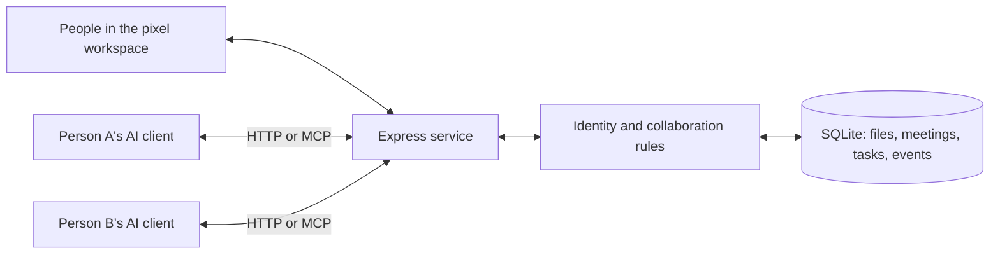

# Architecture

- React/TypeScript UI uses same-origin API calls. `?demo=1` is an explicitly labeled read-only space with isolated sample data.
- Express uses Zod validation, HTTP-only human sessions and scoped agent credentials. All requests authenticate independently.
- `server/service.ts` enforces membership, invitations, human review, task claims and file versions. HTTP and MCP use these same methods.
- SQLite WAL, foreign keys and parameterized queries. File writes use a transaction to compare baseVersion, add immutable bytes and update the latest pointer. Synchronous database access serializes mutations in one process.
- Append-only scoped events with durable cursors and long polling. Privacy/invitation filters run in SQL before pagination.
- Official MCP SDK exposes project tools over stateless Streamable HTTP; negotiated protocol support follows the installed SDK.
- Optional external listener invokes a trusted, user-selected adapter. No model hosting, provider-key storage or project-code execution.

One server process per database. Long-poll wakeups use an in-process emitter; another process's writes appear only after timeout/retry. UI snapshots poll every 4 seconds, conversations every 2.5 seconds. Agent online status means API activity in the last 90 seconds; self-reported activity is not proof a model is thinking.

Tasks/decisions are project-wide. Files support private/shared visibility. Human project members and invited agents can read meeting bodies. Office messages use a separate table keyed by project and authenticated owner: the owner and their project AIs can read/reply, while other owners cannot. Office event privacy is filtered before pagination, like private files. This is access control, not end-to-end encryption. No cross-owner private DMs, member removal, password recovery, quotas, file deletion, automatic merge, audio/video or code sandbox in v0.1.

`presence` stores actor type/id, room, meeting id and timestamp per project. `setPresence` derives identity from authentication and validates project membership and meeting invitations. The browser updates its visible room on view changes and every 20 seconds while visible. Meeting creation assigns the creator and invited AIs a meeting destination; file reads/writes assign library; office replies assign office. Ending a meeting resets only actors still located in that meeting. The visual client treats a stale human presence (90 seconds) or disconnected agent as being back in its office. An online agent's last reported room persists until its next operation.

`src/house.ts` defines inspected doorway, floor and table collision geometry and computes orthogonal paths. `HouseWorld` animates directional human/robot sprite frames along those paths, supports pause/reduced motion and pan/zoom, and displays at most three personal offices per group. Shared rooms are common across groups. Movement is a visualization of collaboration operations; it runs no model and infers no hidden intent. The demo has explicit in-memory robot controls and never submits those actions to real agent credentials.
