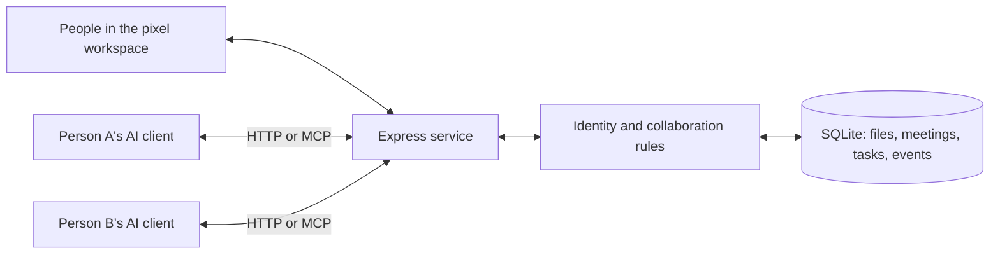

# Architecture

- React/TypeScript UI uses same-origin API calls. `?demo=1` is an explicitly labeled read-only space with isolated sample data.
- Express uses Zod validation, HTTP-only human sessions and scoped agent credentials. All requests authenticate independently.
- `server/service.ts` enforces membership, invitations, human review, task claims and file versions. HTTP and MCP use these same methods.
- SQLite WAL, foreign keys and parameterized queries. File writes use a transaction to compare baseVersion, add immutable bytes and update the latest pointer. Synchronous database access serializes mutations in one process.
- Append-only scoped events with durable cursors and long polling. Privacy/invitation filters run in SQL before pagination.
- Official MCP SDK exposes project tools over stateless Streamable HTTP; negotiated protocol support follows the installed SDK.
- Optional external listener invokes a trusted, user-selected adapter. No model hosting, provider-key storage or project-code execution.

One server process per database. Long-poll wakeups use an in-process emitter; another process's writes appear only after timeout/retry. UI snapshots poll every 4 seconds, conversations every 2.5 seconds. Agent online status means API activity in the last 90 seconds; self-reported activity is not proof a model is thinking.

Tasks/decisions are project-wide. Files support private/shared visibility. Human project members and invited agents can read meeting bodies. No private DMs, member removal, password recovery, quotas, file deletion, automatic merge, audio/video or code sandbox in v0.1.
